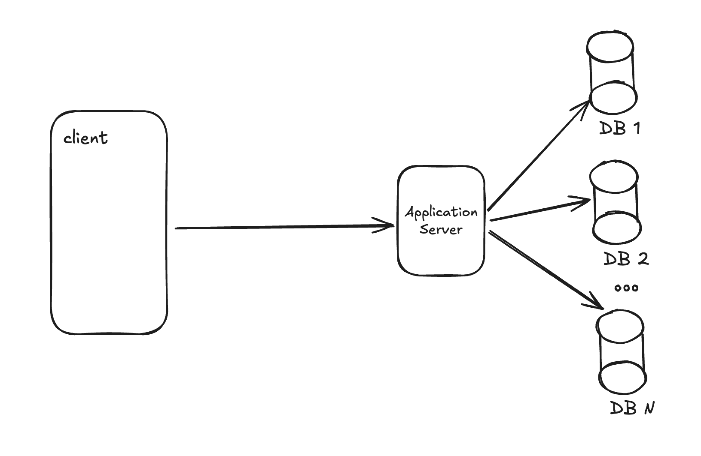
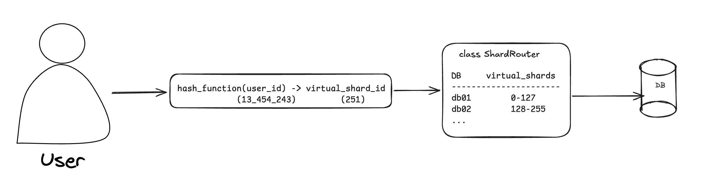
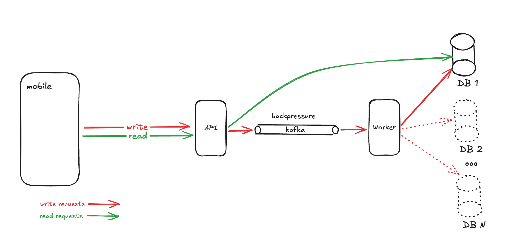

# A Startup's Guide to Sharding Postgres


## Intro

Most projects begin with a single Postgres instance for data persistence, and that is the right call.
For some of them - for the lucky ones - the data keeps growing until one database becomes expensive and risky to operate.
Depending on the workload, there are different answers to scaling the database - sharding is one of them, but outside of system design interviews it is rarely discussed beyond the choice of a sharding key.

We sharded Postgres at the application level for a write-heavy, data-intensive backend.
We started with one instance, have since grown to several, and moved data between them while serving users without UX impact.
This article covers why we did it, how it works, and what went wrong along the way.
It is written for engineers at startups, where the budget matters as much as the architecture.

This article was inspired by [The startup's Postgres survival guide](https://hatchet.run/blog/postgres-survival-guide) by Alexander Belanger of Hatchet.
That guide keeps a single Postgres instance healthy, and this one picks up when a single instance is no longer enough.

## Table of Contents

1. [Our Context](#our-context)
2. [How Big Is Too Big](#how-big-is-too-big)
3. [Alternatives We Rejected](#alternatives-we-rejected)
4. [Application-Level Sharding](#application-level-sharding)
5. [Rebalancing in Production](#rebalancing-in-production)
6. [CDC during Rebalancing](#cdc-during-rebalancing)
7. [Lessons Learned](#lessons-learned)

## Our Context

We are a startup, not a deep-pocketed tech company, so cost and operational complexity drive most of our decisions.

A few words about requirements and the nature of the application's data:

- data is naturally partitioned by the `user_id` with no cross-user_id operations and low risk of hot partitions
- application is write-skewed
- writes go through Kafka, keyed by `user_id`, and a consumer is the only writer to the database
- every write assigns the row a per-user sequence number in the same transaction, and clients sync incrementally by requesting rows above the last sequence they have seen
- deletes are soft (except for legal erasure such as GDPR)
- clients are [local-first](https://en.wikipedia.org/wiki/Local-first_software) iOS and Android apps, with many app versions in the wild.
  They do not need the backend to be useful and may sync overnight while the phone charges, so latency matters little

## How Big Is Too Big

Martin Kleppmann, in "Designing Data-Intensive Applications", calls a system data-intensive when its difficulty comes from the data (its volume, complexity, or rate of change) rather than from computation.
I would add that "big" also depends on who is asking.
What is big for a startup may be peanuts for an enterprise and a rounding error for Big Tech.
For a startup driven by unit economics, a few terabytes of hot transactional data can already be a serious problem.

Many projects start on a single Postgres instance and leave scaling to their future selves.
I am guilty of this too: a couple of years ago I designed a project for ever-growing data with warm and cold storage, and cold storage never made it to production.
Its largest table has since crossed our operational comfort limit, and the costs, risk, and headaches grew with it.
The good news is that this project is moving into the sharded database I'm writing about.

### What Breaks First

Postgres has no hard limit on data size.
The limits come from the operations around it:

- **Disaster recovery**: point-in-time restore of 1TB on AWS can take an hour, plus 1-4 hours of degraded performance while blocks lazily load from S3
- **Vacuum and bloat**: `VACUUM FULL` locks the table for hours, and `pg_repack` needs free disk for a full copy of the table
- **Schema changes**: a humble `ALTER COLUMN TYPE` can rewrite and lock a huge table for hours
- **Indexes**: index rebuilds take hours even with `CONCURRENTLY`
- **Replication and CDC**: replica provisioning takes hours if not days, and a stalled CDC consumer makes the slot hold WAL until it eats the free disk
- **Human errors**: a bad migration has a big blast radius

Most of these come down to disk headroom.
Vacuum, reindex, `ALTER`, and a lagging CDC slot all need free space on top of the data, and you often need it only for a few hours.
But RDS (assuming you're on AWS) does not let you easily shrink allocated storage, so that headroom becomes a permanent part of your bill.
At some point the headroom cost plus the size-dependent risks exceed the cost of one more, smaller instance.

That gives us two limits:

- **The unit of maintenance.**
  Vacuum, reindex, and repack work on one table or partition at a time, so headroom is sized by the largest one.
  We keep it under 100GB including indexes.
- **The instance.**
  Sooner or later you move half of an instance's data to a new node (a "rebalance"), and the whole thing (copy, cut-over, clean-up, repack) should fit into one or two days.
  For us that means at most 1TB including indexes per instance.

We employ different strategies to manage those limits: partitioning to keep the unit of maintenance small and database sharding to keep instance size operationally manageable.
We start preparing a rebalance no later than when the largest instance reaches 700GB.
Splitting at 700GB leaves two instances of 350GB with plenty of room, while splitting at 950GB leaves 475GB each and another split soon.
If you can predict a jump in data volume, say after a feature release, add instances before the data arrives.

## Alternatives We Rejected

### Scaling Without Sharding

Most of the usual options solve read load or CPU, not the size of one instance under heavy writes.
A bigger instance buys CPU and memory, but restore time, vacuum, and headroom still grow with the data.
Read replicas scale reads, while every write still lands on one primary and each replica multiplies the storage bill.
Partitioning keeps the unit of maintenance small, and we use it for that, but the instance keeps growing.
Archiving cold data to a LakeHouse means merging hot and cold data on the read path, with unpredictable latency and painful pagination and deduplication.
Housekeeping, like dropping unused indexes, can free a surprising amount of space, but it is not a growth strategy.

### NoSQL

Naturally partitioned data with no cross-partition operations makes a NoSQL data model a real option.
It is not impossible to build per-user transactional sequencing (a form of the [Transactional Outbox Pattern](https://microservices.io/patterns/data/transactional-outbox.html)) on NoSQL.
I built one on DynamoDB and still maintain it as part of another project.
But it comes with hard trade-offs.
You either duplicate data (secondary indexes, streams) or accept inefficient reads with several expensive round trips between the application and the database.
Each NoSQL engine also brings its own constraints, such as limits on query response size or eventually consistent reads.

Skipping the full trade-off analysis, I'll cherry-pick the considerations that ruled NoSQL out:

- **DynamoDB** storage alone costs about $2.5k/month per 10TB on Standard tables, a Global Secondary Index likely doubles that, and for a write-heavy workload with a transactional sequence update on every write, writes cost even more.
- **Cassandra**, which we already run in a legacy project, writes CDC logs per node, so every write shows up once per replica and needs custom deduplication.
- **ScyllaDB** recently [discontinued](https://www.scylladb.com/source-available-faq/) its open-source releases, and the license came out comparable to DynamoDB.
- Finally, I was the only one on the development team with production NoSQL data modeling experience, and that is a risk in itself.

Postgres gave us transactions for the per-user sequence, mature CDC through Debezium, and expertise across the team.

### NewSQL / Relational

**[AWS Aurora](https://aws.amazon.com/rds/aurora/)** bills storage, I/O, and instance hours separately, which makes it hard to predict and expensive for a startup.
Its storage does shrink when data is removed, which solves the headroom problem, so run your own numbers.

**[YugabyteDB](https://www.yugabyte.com)** looks interesting, but its open-source version could change license as ScyllaDB and CockroachDB did.

### PostgreSQL Sharding Solutions

**[Citus](https://www.citusdata.com/)** suits distributed queries and cross-shard joins, which we don't need.
It adds a coordinator every query passes through, and RDS does not support it.

**[PgDog](https://pgdog.dev/)**, a sharding proxy with online resharding, is worth watching, but its Sharding 1.0 milestone was 41% done when we looked.

These solutions add a layer for queries that span shards - something we do not need.
They also do nothing for disk headroom or operational complexity, and they add a new dependency to manage.

## Application-Level Sharding

For the theory and other examples, see:

- [Shard (database architecture)](<https://en.wikipedia.org/wiki/Shard_(database_architecture)>)
- Instagram, [Sharding & IDs at Instagram](https://medium.com/instagram-engineering/sharding-ids-at-instagram-1cf5a71e5a5c)
- Notion, [Herding elephants: lessons learned from sharding Postgres at Notion](https://www.notion.com/blog/sharding-postgres-at-notion)



With application-level sharding, the application decides which instance to talk to.
Given a shard key, a small router (a class in the application code) looks up the instance in a config map, takes a connection from that instance's pool, and runs the query.
Each instance is an ordinary Postgres that has no idea it is part of a cluster.

In return, you own the router, the config, and the rebalancing tooling.
There are no cross-shard transactions or joins, every migration runs on every instance, and cross-user analytics moves out of Postgres (for us, into a LakeHouse fed by CDC).
When this fits your data model, it is the simplest and most reliable approach, and Instagram and Notion both took it.

### The Sharding Key

A good sharding key is present in every query, never changes, and has high cardinality.
`user_id` meets all three.
High cardinality still does not guarantee even load: paying users often generate more data, and a shard full of churned users gets quieter while one with new users gets busier.
Virtual shards help smooth this out.

### Virtual Sharding

We wanted to start with one instance and add more as data grows, without ever moving all or most of the data across instances (a **full resharding**).
Naive sharding, `hash(user_id) % N`, fails the second goal.
Going from N to N+1 instances changes the modulus and moves roughly N/(N+1) of all users.

**Virtual shards** break the direct link between the key and the instance.
Every `user_id` maps to a fixed virtual shard, `hash(user_id) % 512`, and a small config maps ranges of virtual shards to physical instances.
Adding an instance means moving only the virtual shards assigned to it, and the same mechanism can isolate a hot shard on its own instance.
Use a hash that gives the same result in every language and process; we use MurmurHash3 over the string form of `user_id`.



The router keeps a connection pool per instance and looks up the instance in O(1).
The map lives in git and changes through a pull request, and connection strings live in a secret store.
A mistake in the map sends writes to the wrong instance, so the application checks on startup that the ranges cover all 512 virtual shards with no gaps or overlaps.
If one cluster ever runs out of capacity, several routers can send different groups of users to different clusters.

Every row also stores `virtual_shard_id`, at two bytes per row.
Logical replication filters by it during rebalancing, since Postgres has no built-in MurmurHash3 to compute it on the fly, and the LakeHouse uses it to know which shard a row belongs to.

> [!note] How many virtual shards
>
> Changing this number means a full resharding, so choose carefully.
> It caps the number of physical instances and sets how finely you can move data.
> It should divide evenly by the instance counts you expect.
> Powers of two divide well by 1, 2, 4, 8, 16, and every rebalance can split a range exactly in half, but they divide poorly by 3, 5, or 6.
> Notion chose 480 because it divides by many small numbers.
> Our data is spread evenly, so we took 512 and split ranges in half.

To keep the terms straight: **rebalancing** moves virtual shards between instances and keeps the hash and the shard count.
**Resharding** changes the scheme itself and moves most rows, and we designed the system so we never need it.

## Rebalancing in Production

Take the simplest case, adding a second instance to a single-instance cluster.
Source holds all 512 virtual shards, and the new Target should take 256-511.

1. **Prepare** both instances: provision Target, apply migrations, enable logical replication on Source.
2. **Copy** the data from Source to Target with logical replication filtered by `virtual_shard_id BETWEEN 256 AND 511`.
3. **Settle** Target: wait for the initial copy, let the lag drop, refresh statistics.
4. **Cut over**: stop writes, wait for zero lag, switch reads and writes for 256-511 to Target, stop replication, resume writes.
5. **Fix index bloat** on Target.
6. **Clean up** shards 256-511 on Source.

Everything except the cut-over runs with the application fully online.
The cut-over is hard because replication must stop exactly when writes start going to Target, and the two cannot be made atomic.
We call the time between stopping and resuming writes the **cut-over window**.
Reads keep working during it, but writes wait for a couple of minutes.

### Preparation

Most of the risk can be removed before the rebalance starts.

- Set `wal_level = logical` (on RDS, `rds.logical_replication`) well ahead, ideally before production, because it needs a restart.
  Check `max_replication_slots` and `max_wal_senders`, since the rebalance and CDC both need slots.
- Run the same Postgres major version on both sides.
- Apply migrations to Target with your usual tooling, and freeze schema changes until the cut-over, because logical replication does not replicate DDL.
- Give both instances disk headroom for WAL, since replication and CDC slots hold it.
- Grant the replication user its role and read access only for the rebalance.
- Make sure you can stop all writers at once: disable their autoscaling and check that queue retention is far longer than the pause.
- Render scripts for this particular rebalance, so nobody edits SQL by hand during the window, and run the same scripts in integration tests first.
  Fill in a checklist as you go; it becomes your log and a source of optimization ideas for the next rebalance.

### Copying with Logical Replication

We use row-filtered logical replication, available since Postgres 15:

```sql
-- on Source
CREATE PUBLICATION rebalance
  FOR TABLE your_table WHERE (virtual_shard_id BETWEEN 256 AND 511)
  WITH (publish_via_partition_root = true);  -- required for partitioned tables

-- on Target
CREATE SUBSCRIPTION rebalance
  CONNECTION 'host=... dbname=... '
  PUBLICATION rebalance
  WITH (copy_data = true);
```

**Set the replica identity first.**
A row filter on a publication that publishes `UPDATE` and `DELETE` may only use columns from the table's replica identity, and the default (the primary key) does not include `virtual_shard_id`.
Postgres does not check this when you create the publication.
`CREATE PUBLICATION` succeeds, and then your application's updates and deletes on Source start failing with "Column used in the publication WHERE expression is not part of the replica identity".
So change it before creating the publication:

```sql
ALTER TABLE your_table REPLICA IDENTITY FULL;
```

On partitioned tables, the row filter requires `publish_via_partition_root = true`, and the replica identity does not propagate from the root, so **set it on every partition**.

`FULL` has a price.
On Source, every update and delete writes the whole old row to WAL.
On Target before Postgres 16, every replicated update and delete finds its row with a sequential scan.
The alternative is `REPLICA IDENTITY USING INDEX` with a unique index that includes `virtual_shard_id`, which costs one more, very inefficient index.
Set `REPLICA IDENTITY DEFAULT` back on the table and every partition at the cut-over, right after dropping the publication.

`copy_data` (the default) copies the existing rows before streaming changes.
Each table is copied in one long transaction, during which vacuum on Source cannot remove dead rows, and `max_sync_workers_per_subscription` (2 by default) caps how many tables copy in parallel.

### Settling the Target

A table has finished its initial copy when it reaches sync state `r`:

```sql
-- on Target
SELECT srrelid::regclass, srsubstate
FROM pg_subscription_rel
WHERE srsubstate <> 'r';
```

Measure the lag on Source, not Target.
`pg_stat_subscription` on Target can look healthy while Target is far behind, and the reliable number comes from the replication slot:

```sql
-- on Source
SELECT slot_name,
       pg_size_pretty(pg_current_wal_lsn() - confirmed_flush_lsn) AS behind
FROM pg_replication_slots
WHERE slot_name = 'rebalance';
```

While the application writes, look for a small, stable lag; it reaches zero only after writes stop.

A freshly copied table has no planner statistics, so the first minutes after the cut-over can get really slow.
Autovacuum will analyze the tables on its own, but it takes a while, so let it finish before the window.
Then check `last_analyze` and `last_autoanalyze` in `pg_stat_user_tables` and run `ANALYZE` by hand where needed.
We learned this the hard way, when running `ANALYZE` inside the window only made the window longer.

### Cut-over

Since stopping replication and switching writes cannot be atomic, you either make sure nothing is written during the switch or make the overlap harmless.

**Dual write** takes the second route: the application writes the moved shards to both instances while replication runs, and there is no pause.
But a row must come out identical on both sides whichever write lands first, so the database cannot compute any value such as `now()`, an id, or a counter.
Our per-user sequence is assigned in the database, which rules dual write out, and it would also double write latency.

**Rolling update** is a cheaper variant of dual write.
Instead of writing to both instances, you roll out the new config gradually: old workers write to Source, which replicates to Target, and new workers write to Target directly.
The same condition on writes applies.

Since the per-user sequence rules out both dual write and rolling update, we **pause writes**.
Our local-first clients retry and do not need read-your-writes, and Kafka on the write path buffers writes, so users notice nothing.
Without Kafka, rejecting writes for the window would work just as well for a local-first client.



#### The procedure

1. **Stop all writers.**
   Scale the Kafka consumers to zero.
   Writes pile up in Kafka, reads keep working, and the window starts.
2. **Wait for replication to settle.**
   Every table on Target is in state `r`, and the lag on the Source slot is exactly zero.
3. **Switch the shard map with writers still at zero.**
   If writers scale up together with the map change, their writes clash with the still-running replication and fail with `duplicate key` errors.
4. **Stop replication.**
   On Target, detach the subscription from its slot first, so the drop does not need a connection to Source:

   ```sql
   ALTER SUBSCRIPTION rebalance DISABLE;
   ALTER SUBSCRIPTION rebalance SET (slot_name = NONE);
   DROP SUBSCRIPTION rebalance;
   ```

   Then drop the publication and the slot on Source, and set `REPLICA IDENTITY DEFAULT` back.

5. **Resume writers.**
   The consumers drain the Kafka backlog into Target, and the window ends.

Step 5 is the point of no return.
Until then, you roll back by reverting the map, because Source still has every row.
Once consumers write to Target, Source falls behind, and going back would need replication in the opposite direction.
That is why the map switch and the writer restart are separate changes.

### After Cut-over: Index Bloat

After the copy, indexes on Target were up to twice the size of the same index built from scratch.
`copy_data` inserts rows into tables whose indexes already exist.
With random keys, such as UUIDs or hash-based deduplication keys, each insert lands on a random B-tree leaf, full pages split in half, and the halves never fill up again.
An index built in one pass from sorted data packs its pages densely.

The fix is a rebuild:

```sql
REINDEX INDEX CONCURRENTLY your_table_pkey;
```

`CONCURRENTLY` keeps the table available, but it needs free disk for a full copy of the index, takes hours on large ones, and writes a lot of WAL for your CDC slot to process.
Rebuild one index at a time, estimate the gain first with `pgstatindex` from `pgstattuple`, and check the result with `pg_relation_size`.
We do this after the cut-over, because bloat does not affect correctness and every hour of replication piles up WAL on Source.

### Clean-up

After the cut-over, Source still holds every row of the moved shards - they have to be cleaned.
This sounds like the easy part, but it turned out to be the hardest: we delete a large share of the rows in the biggest tables.

We have no index on `virtual_shard_id` and do not want one, given its size and low selectivity, so finding the rows means scanning the table.
Naive batching, `DELETE ... WHERE virtual_shard_id BETWEEN ... LIMIT n` in a loop, degrades.
Each batch scans from the start of the table past more and more dead rows, until a batch takes many minutes.
`VACUUM` between batches helps only for a while.

Instead, we batch by physical location.
Every row has a `ctid` (block number and position in the block), and since Postgres 14 a `ctid` range runs as a Tid Range Scan that reads only those blocks.
So we walk the table in fixed chunks of blocks, one transaction per chunk:

```sql
DELETE FROM your_table
WHERE ctid >= '(0,0)'::tid AND ctid < '(512,0)'::tid
  AND virtual_shard_id BETWEEN 256 AND 511;
-- next batch: (512,0) .. (1024,0), and so on up to the last block
```

Each batch now costs about the same, so the total time is predictable.

**Watch the WAL.**
Every deleted row goes to WAL, and the CDC slot holds it until the consumer chews through millions of delete events.
If you delete faster than CDC consumes, WAL eats the free disk.
Throttle the batches and pause when the slot lag grows; we had to stop and resume several times.

**Watch autovacuum.**
Mass deletes trigger autovacuum, which competes for I/O and writes WAL of its own.
Disabling it in the RDS parameter group did not work for us, only the per-table setting did:

```sql
ALTER TABLE your_table SET (autovacuum_enabled = false);
-- and back to true when the clean-up is done
```

Even that is not a guarantee.
In one rebalance, vacuum started anyway mid-clean-up, and together they pushed disk usage past the RDS storage autoscaling threshold.
Keep an eye on the RDS I/O burst balance as well, because draining it degrades performance.

**Don't expect the disk back.**
Postgres reuses the freed space for new rows, but the files do not shrink.
That is fine for us, because Source grows back into the space it already pays for.

> [!tip] Another option
> Some applications can make `virtual_shard_id` the first column of the primary key:
>
> ```sql
> PRIMARY KEY (virtual_shard_id, id)
> ```
>
> Then both the clean-up and the replication filter get an index for free.
> But this affects query design, index size, foreign keys, uniqueness and deduplication, ORM support, and CDC.

## CDC during Rebalancing

Every instance streams changes to our LakeHouse with Debezium through its own slot.
The LakeHouse should not notice a rebalance: the copy must not look like new data, the hand-over must leave no gaps or duplicates, and the clean-up must not look like deletes.

**Start CDC on Target inside the cut-over window.**
A CDC slot on Target during the copy would emit every copied row as an insert, millions of duplicates.
So we create it after the lag reaches zero and before writers resume.
Every change before that point reached the LakeHouse through Source, and every change after it comes through Target.
The write pause gives us this boundary for free.
Target's Debezium connector also runs with `snapshot.mode = never`, since a default snapshot would cause the same flood.

**Rewrite row ownership.**
Each LakeHouse record carries the instance it came from, so after the cut-over we update that attribute for the moved shards.

**Ignore the clean-up deletes.**
Soft deletes make this easy.
Physical deletes in the stream come only from the clean-up or from legal erasure, which purges the LakeHouse through its own process, so CDC can safely skip them.
Without soft deletes, it would need to know which shards moved and drop their deletes from Source.

**Mind the WAL on Source.**
Until the cut-over, Source has two slots holding WAL, and `REPLICA IDENTITY FULL` makes every change heavier.
In a non-production rehearsal, WAL grew far more than we expected, and we had to drop the CDC connector and restore it later.
Since then we watch both slots as closely as free disk.

## Lessons Learned

- **Shard from day one, even on one instance.**
  A router, virtual shards, and a `virtual_shard_id` column cost almost nothing when data is small, and retrofitting them is a project of its own.
- **Shrink the cut-over window.**
  Only replication catch-up, the config switch, and stopping replication need stopped writes, and each of our rebalances kept less inside the window.
- **Plan by the clean-up.**
  The copy takes hours and the cut-over minutes, but the clean-up takes days.
- **Storage autoscaling is a one-way door.**
  A short spike during clean-up becomes a permanent cost.
- **Not every growth problem needs a new instance.**
  Rebuild bloated indexes first, or move virtual shards between existing instances.
- **Forecast, don't react.**
  The active part of a rebalance takes a couple of days, but planning, alignment, and infrastructure setup take weeks of calendar time, so track the largest instance's monthly growth.
- **Prefer writes the application controls.**
  Soft deletes and app-computed values keep CDC simple and dual write possible.
- **Run Postgres 16 or newer.**
  Row filters need 15, and 16 lets the subscriber use indexes for tables with `REPLICA IDENTITY FULL`.
- **Test with several databases.**
  Cover the shard router and rebalance process with integration tests that run against several instances.
  Make sure your rebalance integration tests use **exactly the same scripts** as the real rebalance, so the runbook and scripts are proven.
  Rehearse the first rebalance while the data is small.

- **One size doesn't fit all.**
  If your clients need read-your-writes, or you have hard deletes and non-idempotent writes, a simple write pause may not be enough.
